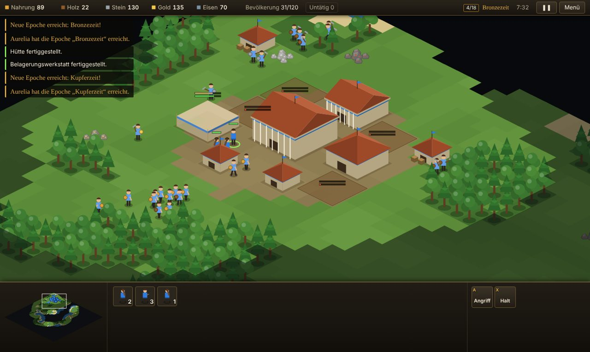
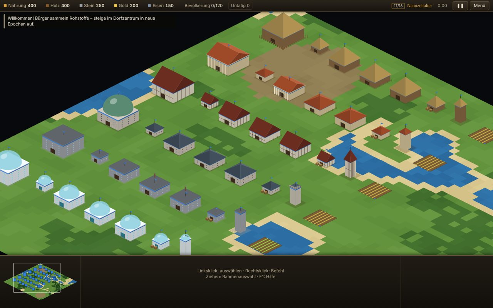
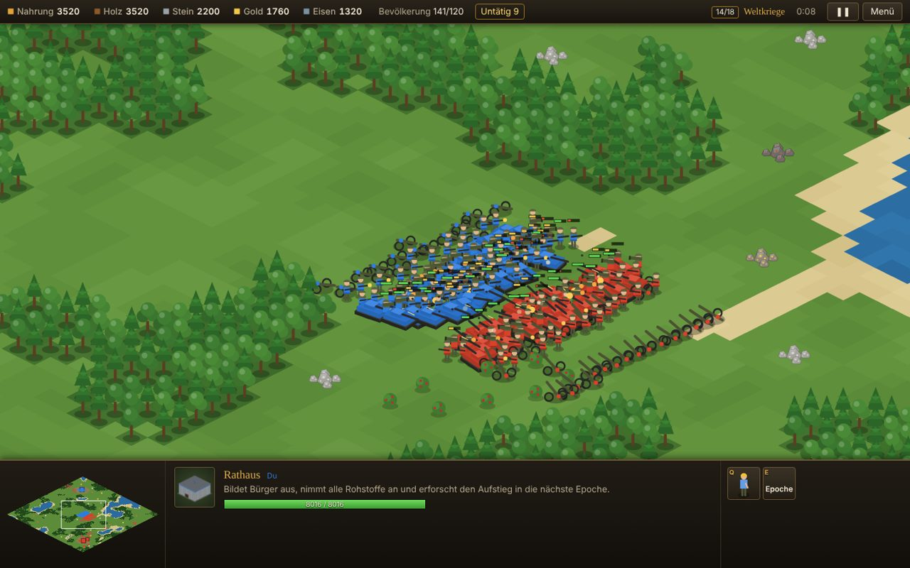

# EmpireMarv

Echtzeitstrategie über **18 Epochen** der Menschheitsgeschichte – von Keulenkriegern in der Urzeit bis zu Titan-Mechs im Weltraumzeitalter. Ein geistiger Nachfolger der klassischen Epochen-RTS, spielbar direkt im Browser.



> **Status: spielbarer Prototyp (v0.6).** Wirtschaft, Kampf, 18 Epochen, 189 Technologien, Mauern und Tore, Späher, KI-Gegner, Fog of War, Ton und Musik, Befehlsketten und Formationen, Mehrspieler per Link, Wiedergaben sowie **Helden**, **Priester und Propheten** und **Wunder mit Wundersieg** funktionieren. Was als Nächstes kommt, steht in der [Roadmap](docs/GAME_DESIGN.md#roadmap).

## Schnellstart

Voraussetzung: [Node.js](https://nodejs.org) ab Version 20.

```bash
npm install
npm run dev
```

Dann <http://localhost:5173> öffnen, Einstellungen wählen und auf **Spiel starten** klicken.

Mehrspieler lokal ausprobieren, ohne Internet: zwei Tabs mit <http://localhost:5173/?signal=local> öffnen. Im einen ein Spiel erstellen, den Einladungslink im anderen öffnen. Die Tabs finden sich dann über den Browser statt über den Vermittlungsserver.

| Befehl              | Zweck                                   |
| ------------------- | --------------------------------------- |
| `npm run dev`       | Entwicklungsserver mit Live-Reload      |
| `npm test`          | Alle Tests (Simulation, Kampf, KI …)    |
| `npm run typecheck` | TypeScript-Prüfung                      |
| `npm run build`     | Produktionsbuild nach `dist/`           |

## Was schon drin ist

- **18 Epochen** mit eigenem Namen, Zeitraum, Baustil, eigenen Einheiten und einem Emblem mit römischer Ziffer (I–XVIII). Start- und Endepoche sind pro Partie wählbar – wie früher.
- **Aufstieg braucht Gebäude und Forschung**: Jede Epoche verlangt Gebäude der bisherigen Epochen, z. B. für die Bronzezeit ein Kriegerlager, eine Werkstatt und zwei Hütten, und zwei erforschte Techniken der aktuellen Epoche. Der Tooltip zeigt die Checkliste.
- **Technologiebaum mit 189 Techniken** in 28 Zweigen – Waffen, Rüstungen, Werkzeuge, Bergbau, Ackerbau, Medizin, Schrift, Mathematik, Antriebe, Glaubensschutz … Jede Epoche schaltet neue Stufen frei, von Feuersteinklingen bis Nanoklingen. Geforscht wird in Schmiede, Akademie, Tempel und den Produktionsgebäuden.
- **5 Rohstoffe**: Nahrung, Holz, Stein, Gold, Eisen. Bürger sammeln, bauen und reparieren; Felder liefern unbegrenzt Nahrung. Rechtsklick auf Dorfzentrum oder Lager lagert die Ladung sofort ein.
- **Kampfdreieck**, das über alle Epochen gleich bleibt: Sturminfanterie › Abwehrinfanterie › Kavallerie & Fahrzeuge › Fernkampf › Sturminfanterie. Belagerung und Artillerie zerstören Gebäude.
- **14 Gebäudetypen**, deren Namen und Aussehen mit der Epoche wechseln (Hütte → Haus → Wohnblock → Wohnturm). Beim Aufstieg zieht die ganze Stadt in die neue Ära um.
- **12 Gebäudetypen**, deren Namen und Aussehen mit der Epoche wechseln (Hütte → Haus → Wohnblock → Wohnturm). Beim Aufstieg zieht die ganze Stadt in die neue Ära um.
- **Zuflucht**: Auf Knopfdruck im Dorfzentrum (`Z`) suchen sich alle Bürger einen Platz im nächsten Dorfzentrum oder Turm, bis zu 5 je Gebäude. Jeder Bürger darin schießt einen zusätzlichen Pfeil. Erneut drücken gibt Entwarnung, alle gehen an ihre Arbeit zurück.
- **Mauern und Tore**, als Linie gezogen: Palisade, Lehmziegel, Zinnenmauer, Bastion, Beton, Energiebarriere. Tore lassen nur das eigene Team durch.
- **Späher** mit großer Sichtweite und **Erkundenmodus** für jede Einheit.
- **Moral**: Häuser stärken Einheiten in ihrer Nähe – sichtbar als Punkte am Lebensbalken und als Kreis um das Haus.
- **Helden** aus dem Dorfzentrum, je einer pro Art: Der **Stratege** führt (Aura: Moral und Heilung) und hat Sammelruf, Schildwall und Feldlazarett. Der **Krieger** feuert an (Aura: +15 % Angriff) und hat Kampfschrei, Wirbelschlag und Blutrausch. Beide tragen je Epoche einen neuen Titel, vom Häuptling bis zum Kommandanten, vom Recken bis zum Elitekämpfer.
- **Tempel, Priester und Propheten**: Priester heilen und **bekehren** gegnerische Einheiten. Propheten rufen mit Glaubenspunkten **Seuche, Erdbeben, Feuersturm und Sturm** herab, die nur Gegner treffen. Gegenmittel erforscht man im Tempel: Glaubensschutz, Heilkunst, Katastrophenschutz, Glaubenseifer.
- **Wunder**: eines je Ära mit eigener Wirkung, vom Steinkreis (schneller sammeln) über Große Bibliothek, Kathedrale, Kaiserpalast und Sendeturm bis zum Weltraumlift (schneller forschen). Mit **Wundersieg** (aus/5/10/15 min) gewinnt, wessen Wunder so lange steht.
- **Lesbarkeit**: Einheiten, Minen und Büsche hinter Gebäuden scheinen durch.
- **Ton und Musik**, komplett im Browser erzeugt, ohne Audiodateien: Waffen klingen nach ihrer Epoche (Schleuder, Bogen, Muskete, Gewehr, Kanone, Laser), Bürger hacken, schürfen und hämmern, Einheiten antworten auf Befehle. Ein Alarm passend zur Ära (Kriegshorn, Glocke, Signalhorn, Sirene) und eine Fanfare beim Aufstieg. Die Musik wird für jede Ära neu komponiert, von der Knochenflöte bis zum Synthesizer, und wird im Kampf treibender. Man hört nur, was man sieht.
- **KI-Gegner** in drei Stufen: baut Wirtschaft und die nötigen Gebäude auf, steigt in Epochen auf, erkundet mit Spähern, mauert ihre Basis ein, verteidigt, greift in Wellen an und kontert deine Armee. Sie setzt Helden und ihre Fähigkeiten ein, bekehrt, ruft Katastrophen auf deine Truppen, baut Wunder und greift fremde Wunder gezielt an.
- **Formationen** Linie, Block und Keil: Infanterie vorn, Fernkampf und Belagerung hinten. Gruppen marschieren im Gleichschritt und kommen gleichzeitig an. Rechts-Ziehen legt die Blickrichtung mit einem Pfeil fest.
- **KI-Gegner** in drei Stufen: baut Wirtschaft und die nötigen Gebäude auf, steigt in Epochen auf, erkundet mit Spähern, mauert ihre Basis ein, verteidigt, greift in Wellen an und kontert deine Armee.
- **Formationen** Linie, Block und Keil: Infanterie vorn, Fernkampf und Belagerung hinten. Gruppen marschieren im Gleichschritt und kommen gleichzeitig an (mit `L` abschaltbar). Nach einem Sieg im Gefecht greifen Soldaten zuerst die nächste feindliche Einheit an, erst dann Gebäude. Rechts-Ziehen legt die Blickrichtung mit einem Pfeil fest.
- **Befehlsketten** mit Umschalt: Wegpunkte, Angriffe, Sammeln und mehrere Bauaufträge nacheinander. Die Wegpunkte sind als Linien sichtbar. Dazu **Patrouille** und **Sammelpunkt-Ketten**.
- **Gebäude-Hotkeys und Produktionsleiste**: `Tab` plus Bau-Taste springt zu Kaserne, Stall & Co. (untätige zuerst). Eine Leiste zeigt jedes Produktionsgebäude mit laufendem Auftrag, Warteschlange und untätigem Zustand. Mehrere Gebäude eines Typs bilden gemeinsam aus, Forschung und Aufstieg lassen sich einreihen.
- **Fog of War**, Minimap, Sammelpunkte, Kontrollgruppen mit Gruppenleiste, Angriffsbewegung, Anzeige untätiger Bürger.
- **Mehrspieler per Link** für bis zu 4 Plätze, Menschen und KI gemischt, Teams frei wählbar (1 gegen 1, 2 gegen 2, zu zweit gegen die KI). Gastgeber erstellt das Spiel und teilt den Link, die Browser verbinden sich direkt. Verbündete teilen die Sicht. Dazu Chat (an alle oder ans Team), Kartenmarkierungen, gemeinsame Pause. Verliert jemand die Verbindung, wartet die Partie bis zu 60 s, dann übernimmt der Computer. Wer den Tab neu lädt, steigt über denselben Link wieder ein.
- **Wiedergaben**: Jede Partie wird automatisch mitgeschnitten (nur Einstellungen und Befehle, wenige Kilobyte). Ansehen im Menü unter „Wiedergaben“ oder als Datei speichern und weitergeben. Beim Ansehen: Tempo bis 16×, vor- und zurückspringen, Sicht jedes Spielers oder alles aufgedeckt.
- **Deterministische Simulation**: Gleicher Seed und gleiche Befehle ergeben dieselbe Partie, auch über Chrome, Firefox und Safari hinweg (eigene Trigonometrie statt `Math.sin` & Co.). Darauf bauen Mehrspieler und Wiedergaben auf.



## Steuerung

| Eingabe                         | Wirkung                                             |
| ------------------------------- | --------------------------------------------------- |
| Linksklick / Ziehen             | Auswählen / Rahmenauswahl                           |
| Doppelklick                     | Alle sichtbaren Einheiten dieses Typs               |
| Rechtsklick                     | Bewegen, Angreifen, Sammeln, Bauen, Einlagern – je nach Ziel |
| Rechts ziehen mit Einheiten     | Ziel und Blickrichtung der Formation (Pfeil)        |
| Rechts ziehen ohne Einheiten, Mitte ziehen | Karte verschieben                        |
| Umschalt + Rechtsklick          | Befehl anhängen (Wegpunkte, Ziele, Bauaufträge); Umschalt halten zeigt die Pläne |
| Rechtsklick mit Gebäude         | Sammelpunkt setzen (Umschalt: weitere Wegpunkte)    |
| `A`, dann Klick                 | Angriffsbewegung                                    |
| `R`, dann Klick                 | Patrouille (Umschalt + Klick: weitere Punkte)       |
| `N` / `O` / `V`                 | Formation Linie / Block / Keil                      |
| `L`                             | Gleichschritt an/aus (Armee ausgewählt)             |
| `Z` (Dorfzentrum/Turm gewählt)  | Zuflucht für alle Bürger, nochmal: Entwarnung       |
| `E`                             | Erkunden (mit Einheiten ausgewählt)                 |
| `M` `W` `L` / `K` `D` `U`       | Stratege: Sammelruf, Schildwall, Feldlazarett / Krieger: Kampfschrei, Wirbelschlag, Blutrausch |
| `S` `B` `F` `T`, dann Klick     | Prophet: Seuche, Erdbeben, Feuersturm, Sturm (Kreis zeigt Fläche und Reichweite) |
| Rechtsklick mit Priester        | Gegner bekehren, Verbündete heilen (auch `C` / `H`, dann Klick) |
| `I` / `D` (Bürger gewählt)      | Tempel / Wunder bauen                               |
| `M` / `G`, dann ziehen          | Mauer / Tor als Linie bauen                         |
| `Entf`                          | Auswahl abreißen bzw. entlassen                     |
| `A`, `S`, `D` … (Gebäude gewählt) | Nächste Stufe eines Forschungszweigs              |
| `F2` oder „Forschung“           | Technologiebaum                                     |
| Buchstaben                      | Befehle (stehen auf den Knöpfen, z. B. `H` = Haus)  |
| Umschalt + Bauen / Ausbilden    | Mehrfach platzieren, nacheinander bauen / 5 Einheiten |
| `Strg`+`1–9`, dann `1–9`        | Gruppe speichern / wählen (zweimal: hinspringen); auch über die Gruppenleiste |
| `X`                             | Halt (leert auch die Befehlskette)                  |
| `Tab`, dann Bau-Taste           | Gebäude dieses Typs wählen (untätige zuerst); nochmal = nächstes, 2× schnell = hinspringen |
| Doppelklick / Rahmen auf Gebäude | Alle gleichen Gebäude: Ausbilden und Forschen verteilen sich |
| `.`                             | Nächster untätiger Bürger                           |
| `Pos1`                          | Dorfzentrum                                         |
| Leertaste                       | Zum letzten Angriff springen                        |
| Pfeiltasten, Bildschirmrand, Mausrad | Kamera bewegen und zoomen                      |
| `+` / `−`                       | Spielgeschwindigkeit                                |
| `P` / `Esc` / `F1`              | Pause / Menü / Hilfe (im Mehrspieler pausiert `P` für alle) |
| `Enter` / Umschalt + `Enter`    | Mehrspieler: Chat an alle / ans Team (`Tab` wechselt beim Schreiben) |
| `Alt` + Klick                   | Mehrspieler: Stelle für Verbündete markieren (auch auf der Minikarte) |
| `Strg`+`M` oder 🔊              | Ton ein/aus; Lautstärke unter Menü → Ton & Musik    |



## Projektaufbau

```
src/
  data/      Spielinhalte als Daten: Epochen, Einheiten, Gebäude, Kampfdreieck
  sim/       Deterministische Simulation: Welt, Befehle, Verhalten, Kampf, Wegfindung, KI
  render/    Isometrische Darstellung, prozedurale Sprites, Minimap
  audio/     Prozedurale Klänge, generative Musik je Ära, Mischpult
  net/       Mehrspieler: Lockstep-Sitzungen, Protokoll, WebRTC, Vermittlung
  ui/        HUD, Eingabe, Startmenü, Lobby, Chat, Wiedergabe-Leiste
  session.ts Woher Befehle kommen: Einzelspiel, Netz oder Wiedergabe
  replay.ts  Aufzeichnen, Speichern und Laden von Wiedergaben
tests/       Vitest: Daten, Wegfindung, Wirtschaft, Kampf, Helden, Glaube, Wunder, KI-gegen-KI, Klänge, Determinismus, Lockstep mit Latenz, Wiedergaben
docs/        Game Design und Screenshots
```

Neue Inhalte entstehen fast immer nur in `src/data/`. Eine weitere Einheitenstufe ist ein Eintrag in `ROLE_DEFS`, eine neue Epoche ein Eintrag in `EPOCHS`.

Das Design, die Epochen-Tabelle und die Roadmap stehen in [docs/GAME_DESIGN.md](docs/GAME_DESIGN.md).

## Veröffentlichen (GitHub Pages)

Der Workflow `.github/workflows/pages.yml` baut das Spiel bei jedem Push auf den Standard-Branch und veröffentlicht den Ordner `dist/`.

Einmalig nötig: unter *Settings → Pages → Build and deployment → Source* **GitHub Actions** auswählen. Mit „Deploy from a branch“ liefert GitHub den Quellcode aus, die `.ts`-Dateien laufen im Browser nicht, und die Seite bleibt leer.

## Mehrspieler: was man wissen sollte

- **Verbindungsaufbau**: Nur der Handschlag läuft über den kostenlosen öffentlichen [PeerJS](https://peerjs.com)-Server (`0.peerjs.com`). Spieldaten gehen direkt von Browser zu Browser. Ist der Server nicht erreichbar, gibt es in der Lobby „Einladung per Code“: Der Gastgeber schickt einen Code, der Mitspieler schickt einen Antwortcode zurück.
- **Nicht jedes Netz klappt**: Ohne Relay-Server (TURN) können strenge Firewalls, manche Firmen- und Mobilfunknetze keine direkte Verbindung aufbauen. Dann erscheint ein Hinweis statt endlosem Warten.
- **Der Gastgeber ist der Taktgeber**: Verlässt er das Spiel, endet es für alle (die Partie lässt sich als Wiedergabe speichern).
- **Gleiche Version**: Alle Spieler brauchen dieselbe Spielversion. Weicht ein Spielstand trotzdem ab, meldet das Spiel es (Prüfsumme jede Sekunde).
- **Datenschutz**: Beim Verbindungsaufbau sehen sich die Browser gegenseitig ihre IP-Adressen, der PeerJS-Server sieht sie ebenfalls.

## Rechtliches

EmpireMarv ist ein eigenständiges Fanprojekt. Es verwendet weder Code noch Grafiken, Namen oder Sounds aus anderen Spielen. Alle Grafiken werden prozedural im Code gezeichnet, alle Klänge und die Musik zur Laufzeit synthetisiert. „Empire Earth“ ist eine Marke ihrer jeweiligen Rechteinhaber und wird hier nur zur Einordnung des Genres erwähnt.
